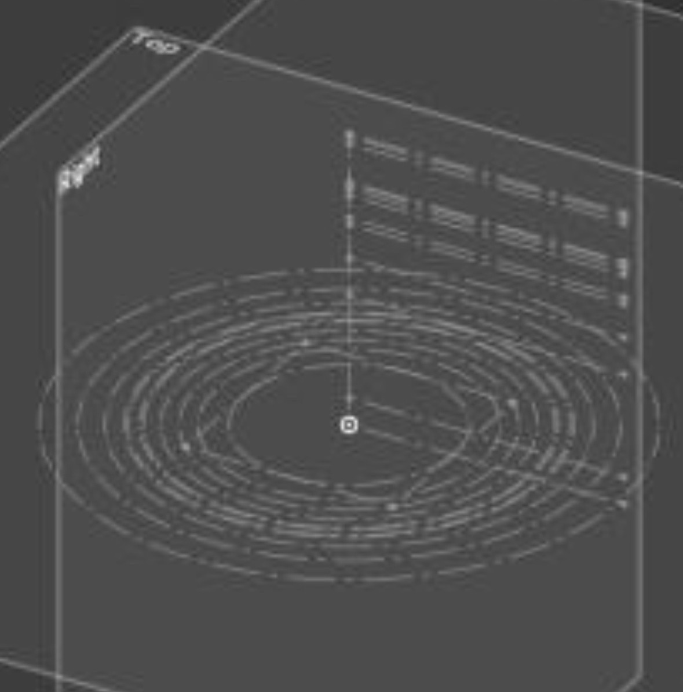

# November 10: Master sketch

I want to make a gearbox for my robot arm that is smooth and works really well. I've seen a lot online and made this basic master sketch. I think a problem I might have is packaging it into a small form factor.

**Total time spent: 0.5 hours**
