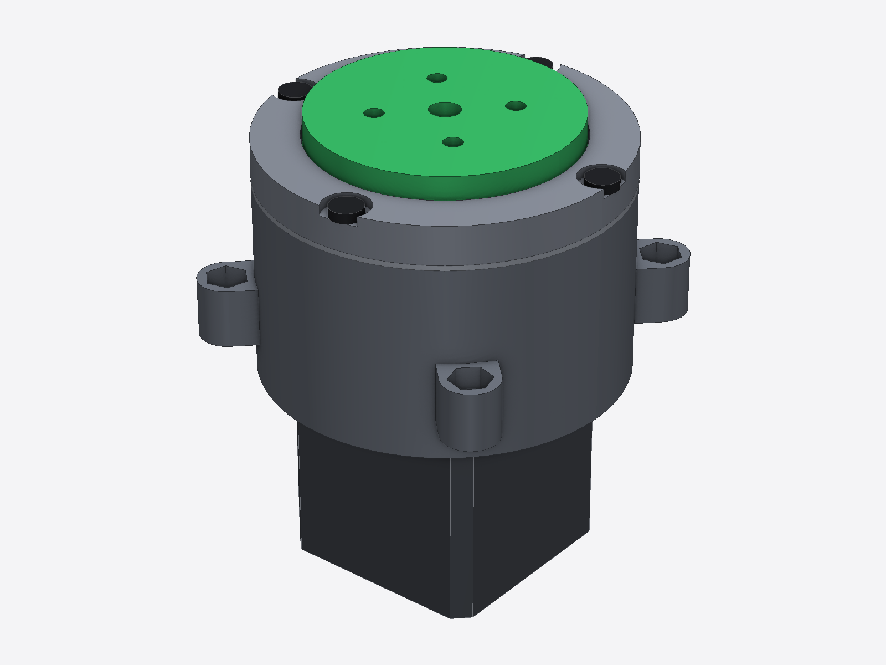
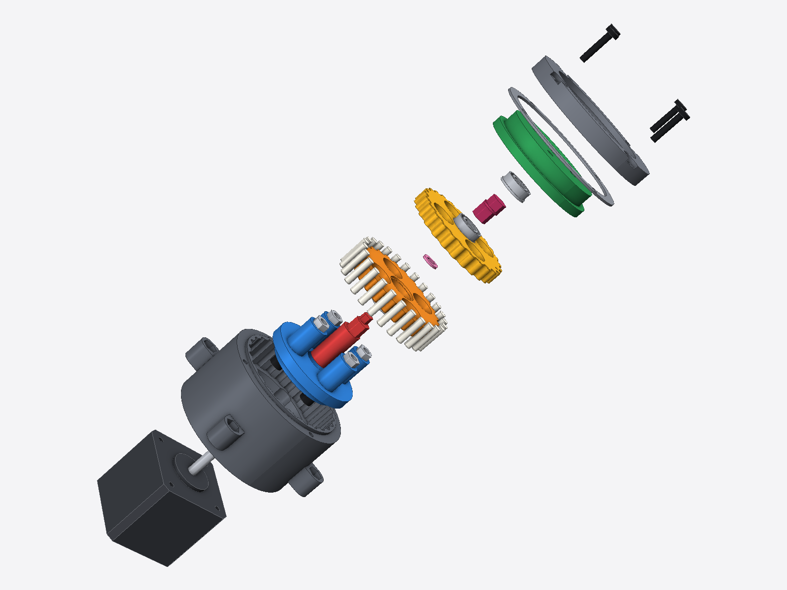
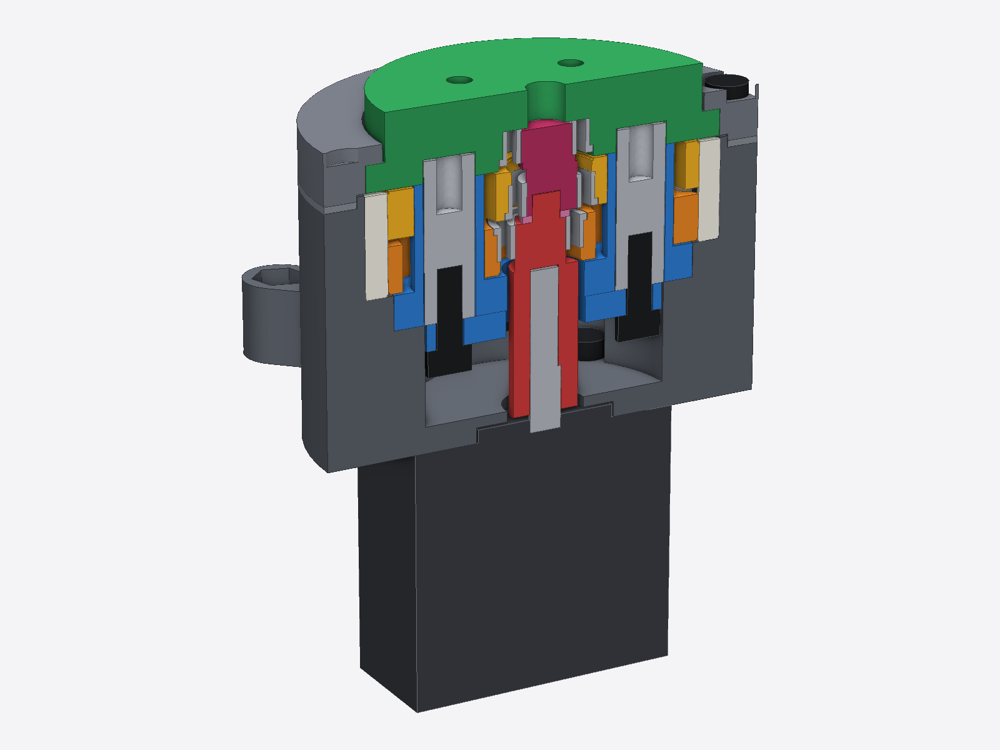
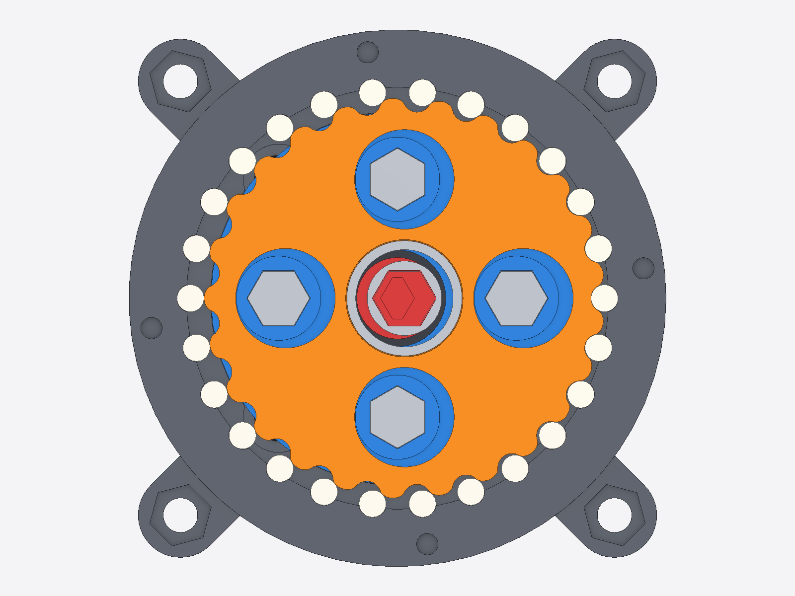
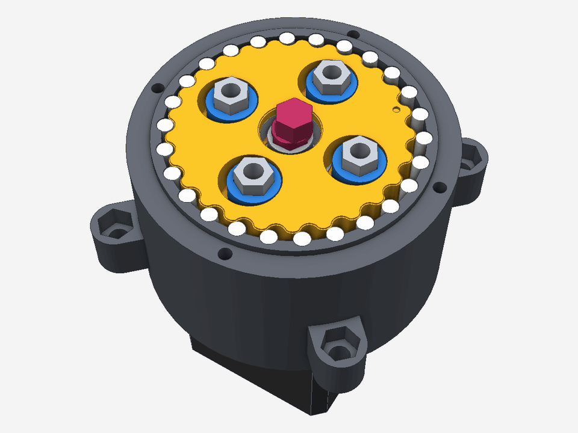

# Cycloidal Gearbox (A43)

A 25:1 cycloidal gearbox for a NEMA 17, almost all 3D printed. Even the rollers are printed.

## Why I made it

My robot arm's shoulder needs a lot more torque than a bare NEMA 17 has. I wanted a gearbox I could make without buying anything: printed parts, plus hardware that was already in my parts bin. A cycloidal drive packs a big reduction into something short, so that's what I went with.

## Specs

- **Ratio:** 25:1
- **Size:** Ø70 mm, 51.3 mm long
- **Motor:** NEMA 17, bolts straight onto the motor face
- **Output:** 4× M4 holes on an 18 mm square
- **Material:** PETG

## How it works

The motor turns an eccentric crank. Two cycloid discs, 180° apart so they balance each other out, roll around a ring of 26 loose printed rollers. Each turn of the motor moves the discs back by one lobe. Four hex standoffs go through holes in the discs and pick up that slow rotation as the output.

I used loose rollers instead of printed teeth because rollers roll rather than slide, and the disc-to-roller contact is where a printed gearbox wears out first.

| Exploded | Cutaway |
|---|---|
|  |  |

See it move

## Hardware

Besides the printed parts it needs:

- 1× NEMA 17 stepper (5 mm D-shaft)
- 3× 8×14×5 mm flanged bearings with an 8 mm hex bore
- 4× 8 mm hex standoffs, 24 mm long, M4-tapped ends (these are the output pins)
- 4× M4×12 socket head screws
- 4× M3×8 screws (gearbox to motor)
- 4× M3×16 screws (cover, self-tapping into the print)
- a bit of grease for the roller pockets

## Making it fit your printer

Printers don't print holes at exactly the CAD size, so there's a tuning kit:

- **Fit coupon:** print this first. It has 4 strips with 5 sizes each, for the bearing seat, the standoff hole, the hex journal and the motor D-bore. Engraved dots tell you which size is which.
- **Tight / loose parts:** the disc, cage, carrier and crank hub come in normal, `_tight` and `_loose` versions. If your best coupon hole has one dot fewer than the normal file, use `_tight`. One dot more, use `_loose`.
- **4 crank journal sizes:** keep the biggest one that slides into the bearing without rocking.
- **Roller sizes:** Ø3.40 / 3.45 / 3.50 / 3.55. Bigger rollers give less backlash, smaller ones run looser. The discs never need a reprint.
- **Shims:** 0.6 to 1.4 mm. Use the thickest one that still turns freely.

## Where the files are

The print files aren't in this repo. They'll be on MakerWorld (link coming soon).

## Status

Designed, fit-tested with the coupon, and being printed now. It hasn't been bench tested yet, so I don't have backlash or torque numbers. I'll add them here once it's built.

It's going into the shoulder of my robot arm, [CyberArm C5-530](https://github.com/CyberBrainiac1/CyberArm-C5-530).

## AI use

I set the requirements and made the design calls. The CAD is parametric Python (CadQuery), and that code is AI-generated. The renders were made with AI-generated code too.

## License

[CC BY 4.0](https://creativecommons.org/licenses/by/4.0/). You can use, change, share, and sell it, as long as you credit me.
